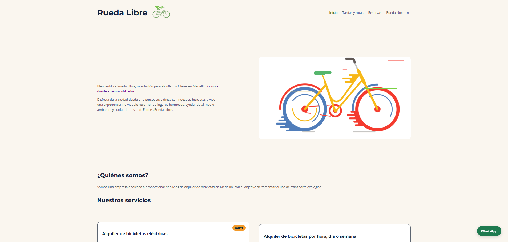
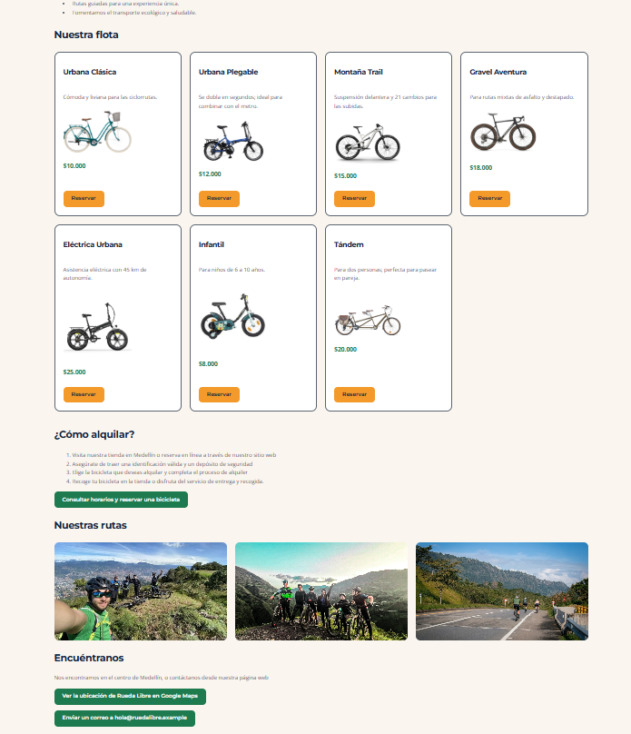
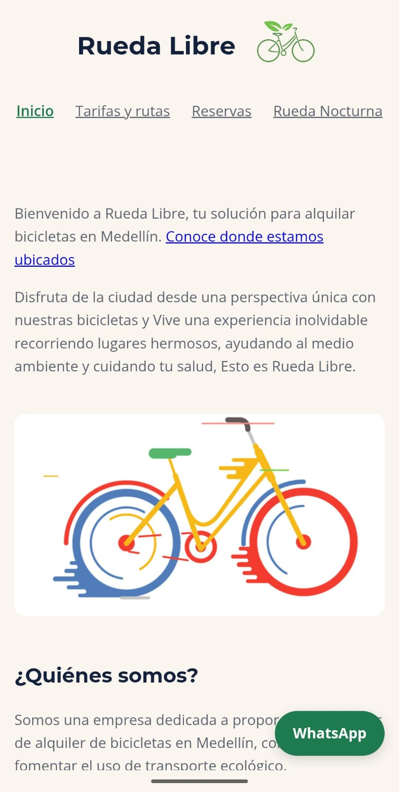
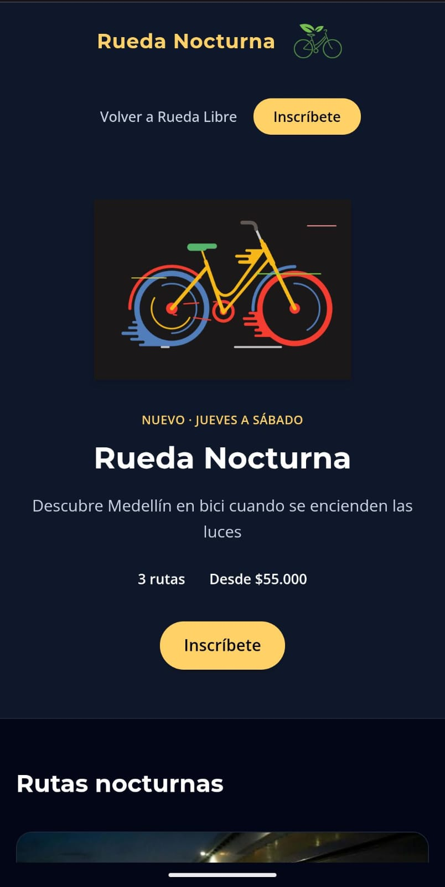
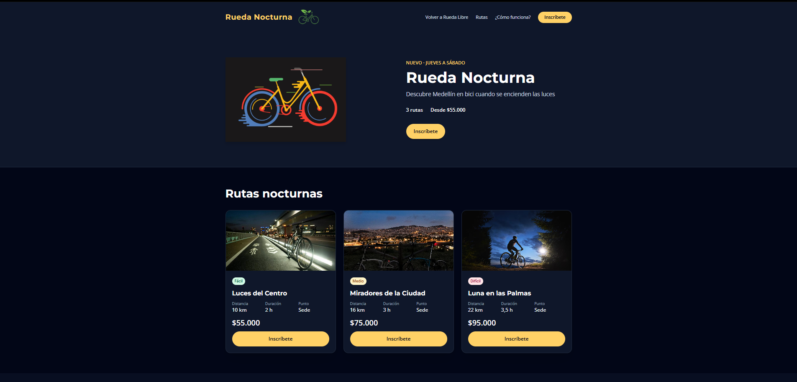
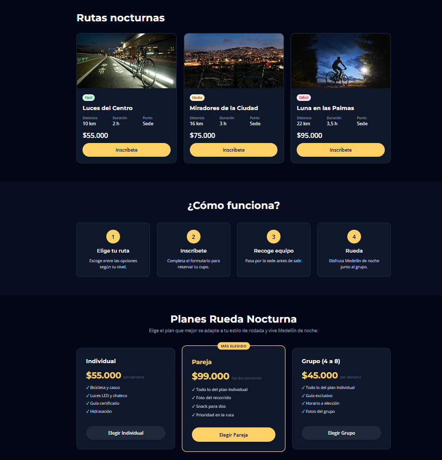

# Rueda Libre v2.0 & Rueda Nocturna (Ecosistema Web Integral) 🚲🌙✨

Proyecto modular multipágina y responsive desarrollado para el negocio de alquiler de bicicletas **Rueda Libre**, integrando el sitio principal de servicios en la raíz y una landing page interactiva con diseño cyberpunk y modo oscuro para el programa **Rueda Nocturna**.

---

## 👥 Autor
* **Coder:** José Daniel Pabón Villanueva (`Dani3VILL_99`)
* **Sede:** Riwi (Cohorte 8+ - Clan TESLA)

---

## 🛠️ Tecnologías Utilizadas

---

## 🌐 Enlaces Publicados
* **Sitio Principal (Rueda Libre v2.0)**: [Ver en GitHub Pages](https://daniel696996.github.io/rueda-libre/)

---

## 🗺️ Mapa de Construcción del Producto Final
Así se integran los 12 MiniRetos de la semana en **Rueda Nocturna: landing en Tailwind integrada al sitio** :

| MiniReto | Qué aporta | Parte del producto que construye | Cómo se conecta con los siguientes |
| :--- | :--- | :--- | :--- |
| **1. Prototipo nocturno con Play CDN** | Hero de la campaña con utilidades y comparación de enfoques. | Sección principal (hero) | Se traslada al proyecto real en el reto 2 |
| **2. Del prototipo al proyecto real: CLI y botones** | Proyecto con Tailwind CLI y tres variantes de botón. | Base técnica y botones | Los botones se usan en las cards (3), el kit (4) y toda la landing |
| **3. Cards de rutas nocturnas** | Card completa para las tres rutas. | Sección de rutas | Se organiza en cuadrícula en los retos 5 y 6 |
| **4. Kit de componentes Rueda Nocturna v0.1** | Alertas, inputs y página de componentes. | Sistema de componentes | Es la fuente de las clases para armar la landing (5) y el formulario (9)|
| **5. Maquetación de la landing** | Layout completo con el kit. | Landing de escritorio | Se vuelve responsive en el reto 6|
| **6. La noche cabe en tu celular: responsive** | Clases mobile-first con prefijos. | Landing responsive | Recibe el tema y el modo oscuro en el reto 7 |
| **7. Marca nocturna: tema propio y modo oscuro** | Colores y fuentes de marca con `@theme` y variante `dark:`. | Identidad de la landing | Los colores coinciden con Bootstrap para integrar ambos sitios (10)|
| **8. Código legible y veredicto: Bootstrap vs Tailwind** | Clases con `@apply`, orden y comparativa con datos. | Mantenibilidad y decisión técnica | La recomendación se documenta en el README (12)|
| **9. Contrarreloj 1: inscripción a Rueda Nocturna** | Formulario de inscripción validado. | Conversión de la campaña | Se enlaza desde el sitio principal en el reto 10|
| **10. Contrarreloj 2: un solo ecosistema** | Navegación y marca coherentes entre sitio y landing. | Integración de productos | El reto 11 amplía la landing ya integrada|
| **11. Contrarreloj 3: requerimiento de última hora** | Sección de planes con box model, Flexbox y Grid. | Oferta comercial | Se incluye en la revisión final (12)|
| **12. Lanzamiento Rueda Nocturna: entrega y demo** | Validación, README, publicación y demo. | Producto final de la semana | Integra los 11 retos anteriores y cierra el módulo|

---

## 📸 Capturas de Pantalla del Proyecto

### 1. Vista de Escritorio (Rueda Libre)

### 2. Vista en Dispositivos Móviles

### 3. Modo Oscuro (Dark Mode Activo)

---

## 💡 Decisiones Técnicas y Veredicto (Bootstrap vs Tailwind)

* **Curva de Aprendizaje:** Trabajar con Tailwind exigió un dominio riguroso y diario de las bases de CSS nativo (Flexbox, Grid y Box Model), guiándome tanto de la investigación de errores como del apoyo entre compañeros. En contraste, explorar Bootstrap permitió entender rápidamente la lógica de frameworks con clases predefinidas desde la primera actividad.
* **Automatización vs. Libertad Creativa:** 
  * *Bootstrap* aporta una automatización total y velocidad para maquetar de forma autónoma, pero limita la originalidad al atar los proyectos a un diseño estándar.
  * *Tailwind CSS* otorga herramientas modulares para construir componentes paso a paso (como los botones y tarjetas personalizados), brindando la libertad creativa exacta para plasmar la identidad nocturna de *Rueda Nocturna* con tonos oscuros y el característico *Amarillo Farol*.
* **Optimización y Tamaño Final:** El proceso de compilación mediante la CLI y la minificación con la opción `--minify` genera un archivo CSS final sumamente liviano de aproximadamente **12.5 KB**, gracias al *Tree-shaking* de Tailwind que elimina de forma automática todas las reglas y clases innecesarias que no se utilizaron en el proyecto.
* **Casos de Uso Recomendados:** 
  * Se recomienda usar *Bootstrap* para proyectos rápidos, corporativos o maquetaciones estandarizadas donde se requiera velocidad sin buscar una alta originalidad visual.
  * Se recomienda usar *Tailwind CSS* para desarrollos minuciosos, landing pages inmersivas y proyectos personales o de marca (como este ecosistema) donde la personalización estética y el modo oscuro nativo eviten la fatiga visual del usuario.

---

## 👨‍💻 Autor
* **Coder:** José Daniel Pabón Villanueva (`Dani3VILL_99`)
* **Sede:** Riwi (Cohorte 8+ - Clan TESLA)
